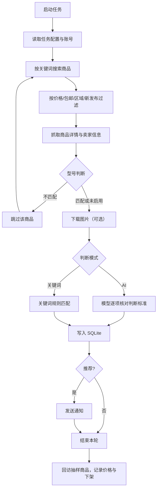

# 闲鱼智能监控系统

[中文] ｜ [English](README_EN.md)

基于 Playwright 和视觉模型的闲鱼多任务监控工具，带完整 Web 管理界面。抓取搜索结果与商品详情，按任务自己的判断标准筛出值得买的商品，命中后推送通知。

当前分支是长期演进的二次开发版，与上游 `Usagi-org/ai-goofish-monitor` 差异较大：任务、结果、价格快照全部存 SQLite；运行配置集中在 `data/config.jsonc`，由 Web 页面维护并加密；新增型号判断、重新分析、已售标记、收藏、价格走势、自动备份、运维采集和 CI 镜像构建。

## 功能

### 监控与判断

- 多任务并发，每个任务独立设置关键词、价格区间、搜索页数、包邮、个人卖家、新发布范围、省市区筛选、账号策略和定时规则。
- 两种判断模式：`AI 判断` 用自然语言需求生成判断标准，交给视觉模型逐项核对；`关键词判断` 按关键词规则命中，适合零成本筛货。
- 型号判断：抓完详情后先确认商品是不是任务要找的型号，不是的不入库。可单独配一个小模型，也可用本地正则预筛。
- 图片分析可关闭，只让模型读标题、描述和卖家信息。
- 任务失败保护：连续失败达到阈值后自动暂停，避免登录态失效时反复请求。
- 账号轮换与代理池轮换，可按任务切换或失败后切换。
- 每轮结束随机回访已入库商品，记录价格和描述变化，卖家下架后标记为已售/已下架。

### Web 管理台

- 监控概览：任务与推荐统计、结果集价格走势、最近动态、策略建议。
- 任务管理：在线创建、编辑、启停、删除；AI 生成判断标准走后台任务，带独立进度弹窗。
- 账号管理：粘贴 Chrome 扩展导出的登录态 JSON，显示有效期，可绑定到任务。
- 结果查看：排序、精细筛选、只看 AI 推荐、屏蔽规则、CSV 导出、删除结果、标注已售/下架、收藏到闲鱼。
- 商品详情：AI 逐项判定、卖家信息、价格参考、本地图片、跳转闲鱼。
- 重新 AI 分析：只重算未分析的商品或全部重跑，可设条数和并发；支持后台执行，弹窗关闭后页面按钮仍显示进度并可取消。
- 运行日志：按任务查看、级别过滤、搜索、导出、清空。
- 运维配置：浏览器行为采样、搜索接口抓包、任务运行选项。
- 系统设置：AI 模型、型号判断、账号与代理轮换、通知渠道、系统状态、内置提示词、配置文件原文编辑。
- 中英文界面切换。

### 通知

支持 Ntfy、PushPlus、Bark、Gotify、企业微信机器人、Telegram、通用 Webhook。每个渠道可单独启用、停用、测试；站内保留最近发送记录和失败原因。推荐商品才发送通知。

## 工作流程



后端 `src.app` 负责 API、静态资源和调度，抓取与分析在独立子进程 `spider_v2.py` 中执行。任务跑完把结论写入 `logs/.run_status_<task_id>.json`，前端通过接口和 WebSocket 获取状态。

## 快速开始

### Docker（推荐）

```bash
git clone https://github.com/hjkl950217/ai-goofish-monitor
cd ai-goofish-monitor
docker compose up -d
docker compose logs -f app
```

默认 Web UI：`http://127.0.0.1:8000`。

`docker-compose.yaml` 默认拉 `ghcr.io/usagi-org/ai-goofish:latest`（上游镜像）。要使用本分支构建的镜像，用环境变量覆盖：

```bash
APP_IMAGE=ghcr.io/hjkl950217/ai-goofish:latest docker compose up -d
```

也可以本地构建：

```bash
docker compose -f docker-compose.dev.yaml up -d --build
```

镜像内置 Chromium，宿主机不需要额外装浏览器。

持久化目录：

| 目录/文件 | 用途 |
| --- | --- |
| `data/` | SQLite 主库、配置文件、密钥、自动备份 |
| `state/` | 闲鱼账号登录态 JSON |
| `prompts/` | 内置提示词模板 |
| `logs/` | 任务日志、AI 请求日志、通知记录、失败保护状态 |
| `images/` | 商品图片缓存 |
| `config.json`、`jsonl/`、`price_history/` | 仅首次启动时用于导入旧数据，之后可以不再挂载 |

### 首次使用

1. 打开 Web UI，用默认账号 `admin / admin123` 登录，随后立刻到「系统设置 → 配置文件」修改密码。
2. 在「系统设置 → AI 模型」填写 `OPENAI_BASE_URL`、`OPENAI_MODEL_NAME`、`OPENAI_API_KEY`，点「测试连接」。
3. 到「账号管理」，用 [Chrome 扩展](#获取闲鱼登录态) 导出登录态 JSON 并添加账号，确认有效期。
4. 到「任务管理」创建任务：选择 AI 判断或关键词判断，填需求、价格、页数、定时和账号策略。
5. 点「启动」立即跑一次；开启任务开关后按定时规则自动运行。

## 配置

### 配置文件在哪里

运行配置只有一份：容器内 `data/config.jsonc`（JSONC，支持注释）。首次启动时，如果这个文件不存在且当前环境里有可迁移的配置值，会用环境变量和 `data/.env` 生成一份；之后以文件为准。没有任何可迁移值时，文件会在第一次保存设置时创建。

- 网页修改：「系统设置 → 配置文件」直接编辑原文，保存后立即重载。
- 敏感字段（API Key、Web 密码、各通知渠道的 token/URL）在文件里存成 `ENC[v1]:...` 密文，密钥在 `data/.config.key`。
- 密钥文件和配置文件必须一起备份。只把 `config.jsonc` 拷到新机器，密文解不开，相关字段要重新填。
- 直接改磁盘上的 `config.jsonc` 需要重启容器才生效；在网页里改会立即重载。
- `WEB_USERNAME`、`WEB_PASSWORD`、`SERVER_PORT` 这类在进程启动时读取的配置，改完建议重启容器。

### 配置优先级

```
data/config.jsonc  >  data/.env  >  进程环境变量  >  仓库根目录 .env  >  代码默认值
```

根目录 `.env` 和 `data/.env` 只用于首次迁移。已经生成 `config.jsonc` 后，改 `.env` 不会覆盖文件里的值。旧部署升级时保留 `.env` 即可，第一次启动会把里面的已知键搬进配置文件。

### 常用配置项

完整键名和注释见设置页的「配置文件」，或 `src/infrastructure/config/store.py`。

| 键 | 默认值 | 说明 |
| --- | --- | --- |
| `OPENAI_API_KEY` / `OPENAI_BASE_URL` / `OPENAI_MODEL_NAME` | 空 | AI 接口必填，模型需要支持图片输入（关闭图片分析时可纯文本） |
| `PROXY_URL` | 空 | 访问 AI 的 HTTP/SOCKS5 代理 |
| `SKIP_AI_ANALYSIS` | `false` | 只抓取不分析 |
| `AI_ANALYSIS_CONCURRENCY` | `2` | 同时分析的商品数 |
| `MODEL_CHECK_ENABLED` | `true` | 是否启用型号判断 |
| `MODEL_CHECK_BASE_URL` / `MODEL_CHECK_API_KEY` / `MODEL_CHECK_MODEL_NAME` / `MODEL_CHECK_PROXY_URL` | 空 | 型号判断专用模型，留空复用主模型 |
| `MODEL_CHECK_PREFILTER_REGEX` | 空 | 本地正则预筛，命中直接放行，不调模型 |
| `SERVER_PORT` | `8000` | 后端监听端口，Docker 内保持 8000 |
| `WEB_USERNAME` / `WEB_PASSWORD` | `admin` / `admin123` | Web 登录账号，生产环境必须改 |
| `RUN_HEADLESS` | `true` | 无头运行浏览器，Docker 中必须为 true |
| `LOGIN_IS_EDGE` | `false` | 本地用 Edge 登录态；容器内固定用 Chromium |
| `KEEP_TASK_IMAGES` | `true` | 保留商品图片供详情页展示 |
| `REFRESH_TRACKED_ITEMS` | `true` | 每轮回访已入库商品，记录价格变化和下架 |
| `PCURL_TO_MOBILE` | 建议 `true` | 通知里附带手机端链接 |
| `IMAGE_DOWNLOAD_CONCURRENCY` | `3` | 图片下载并发 |
| `SELLER_PROFILE_CACHE_TTL` | `1800` | 卖家资料缓存秒数 |
| `ACCOUNT_STATE_DIR` | `state` | 账号登录态目录 |
| `APP_DATABASE_FILE` | `data/app.sqlite3` | SQLite 文件路径 |
| `TASK_LOG_RETENTION_DAYS` | `7` | 任务日志保留天数，启动时清理 |
| `AI_LOG_RETENTION_DAYS` | `1` | AI 请求日志保留天数 |
| `TASK_FAILURE_THRESHOLD` | `3` | 连续失败多少次后暂停任务 |
| `TASK_FAILURE_PAUSE_SECONDS` | `86400` | 暂停时长 |
| `TASK_FAILURE_TZ` | `Asia/Shanghai` | 失败统计时区 |
| `ACCOUNT_ROTATION_ENABLED` | `false` | 任务失败时自动换账号 |
| `ACCOUNT_ROTATION_MODE` | `per_task` | `per_task` / `per_item` |
| `PROXY_ROTATION_ENABLED` | `false` | 代理池轮换开关 |
| `PROXY_POOL` | 空 | 一行一个或逗号分隔 |
| `NOTIFICATION_DISABLED_CHANNELS` | 空 | 站内停用的渠道，逗号分隔 |

通知渠道键：`NTFY_TOPIC_URL`、`PUSHPLUS_TOKEN` / `PUSHPLUS_TOPIC`、`BARK_URL`、`GOTIFY_URL` / `GOTIFY_TOKEN`、`WX_BOT_URL`、`TELEGRAM_BOT_TOKEN` / `TELEGRAM_CHAT_ID` / `TELEGRAM_API_BASE_URL`、`WEBHOOK_URL` / `WEBHOOK_METHOD` / `WEBHOOK_CONTENT_TYPE` / `WEBHOOK_HEADERS` / `WEBHOOK_QUERY_PARAMETERS` / `WEBHOOK_BODY`。留空的渠道不启用。

### 设置页各标签

| 标签 | 管什么 |
| --- | --- |
| AI 模型 | 主模型地址、密钥、模型名、代理、跳过分析；型号判断的独立模型、预筛正则、历史数据校验 |
| IP 轮换 | 账号轮换和代理轮换的开关、粒度、重试上限、黑名单时长、账号目录、代理池 |
| 通知推送 | 七个渠道的配置、启用开关、单渠道测试、全部测试、发送记录 |
| 系统状态 | 版本、运行时长、前端构建时间、数据库大小、备份份数、账号数、磁盘占用 |
| 内置提示词 | `base_prompt.txt`、`example_criteria.txt`、`macbook_criteria.txt`、`model_check_prompt.txt` |
| 配置文件 | `data/config.jsonc` 原文，可格式化、保存并重载 |

## 任务配置

| 字段 | 说明 |
| --- | --- |
| 任务名称 | 唯一标识，日志和结果集都按它归类 |
| 搜索关键词 | 闲鱼搜索框里实际输入的内容 |
| 判断模式 | `AI 判断` 或 `关键词判断` |
| 详细需求 | AI 模式下必填，用自然语言描述要买什么 |
| 判断标准 | AI 根据详细需求生成，也可以手改；只对当前任务生效，存在任务的 `criteria_text` 字段 |
| 分析商品图片 | 关闭后只分析文字和卖家信息 |
| 关键词规则 | 关键词模式下至少一条；单组 OR 逻辑，命中任一即推荐，纯英数字按完整词匹配 |
| 价格范围 | 最低价、最高价，留空不限 |
| 搜索页数 | 每次抓取翻几页搜索结果 |
| 定时规则 | 5 段或 6 段 cron，也支持 `@hourly`、`@daily` 等预设；服务端时区 `Asia/Shanghai` |
| 账号策略 | `auto` 优先用默认登录态，没有则用账号池；`fixed` 固定账号；`rotate` 账号池轮换 |
| 其他筛选 | 仅个人卖家、包邮、新发布范围（最新/1天/3天/7天/14天）、省市区 |

判断标准按任务隔离：重新分析某条商品时，用的是该商品所属任务的标准。任务被改名或删除后，旧商品没有可用标准，会明确报出缺哪个任务。

## 结果与重新分析

- 结果集按关键词归类，一条商品一行，存 `result_items`。
- 排序支持价格、关键词命中数、性价比分值、发布时间、爬取时间；筛选支持价格区间、发布时间、发货地、分析状态、AI/关键词推荐、屏蔽项。
- 黑名单规则按结果集保存，支持普通关键词和 `re:` 开头的正则；命中项从结果页、导出和价格统计里排除，原始数据保留。
- 已售/已下架商品排到最后、整卡置灰并打标签，不进价格样本。手动刷新商品时如果详情已下架，会回写状态。
- 重新分析只重新调用 AI，不重新访问闲鱼。范围可选「仅未分析」或「全部重跑」，可设条数和并发，运行中可取消。「后台执行」会关闭弹窗，工具栏的「重新分析」按钮置灰并显示旋转图标和进度；分析结束后结果列表自动刷新。
- 图片默认只在 AI 判定推荐时保留，非推荐商品的临时图片会被清理。设置页或重新分析弹窗里可以查看并清理图片缓存。

## 数据存储与备份

### SQLite 表

默认库 `data/app.sqlite3`，WAL 模式，启动时自动建表并执行迁移。

| 表 | 内容 |
| --- | --- |
| `tasks` | 任务配置和运行状态 |
| `result_items` | 抓取到的商品、分析结论、推荐状态、上下架状态、原始 JSON |
| `price_snapshots` | 每轮搜索的价格快照，用于价格走势 |
| `favorite_items` | 收藏到闲鱼的商品 |
| `result_blacklist_rules` | 每个结果集的屏蔽关键词 |
| `item_model_checks` | 型号判断结果缓存 |
| `app_metadata` | 建库版本、迁移标记 |

`result_items.result_filename` 仍沿用 `关键词_full_data.jsonl` 的命名，它只是结果集标识，不再对应真实文件。

### 目录结构

```
data/
  app.sqlite3          主库
  config.jsonc         运行配置
  .config.key          配置加密密钥
  .env                 首次迁移来源
  backups/             自动备份
state/                 账号登录态 JSON
prompts/               提示词模板
logs/
  <任务名>_<id>.log    任务日志
  ai/                  AI 请求日志
  notifications.jsonl  通知发送记录
  task-failure-guard.json
  .run_status_<id>.json
images/task_images_<任务名>/  商品图片
dist/                  前端构建产物
```

### 自动备份

- 启动时备份一次，之后每 24 小时一次，用 `VACUUM INTO` 生成一致性副本。
- 位置 `data/backups/app-YYYYMMDD-HHMMSS.sqlite3`，默认保留 7 份。保留份数可用环境变量 `SQLITE_BACKUP_KEEP` 调整（只能通过环境变量设置）。
- 恢复：停容器，把目标备份复制成 `data/app.sqlite3`，删掉同目录的 `-wal`、`-shm`，再启动。
- 备份只覆盖 SQLite。`config.jsonc`、`.config.key`、`state/`、`prompts/`、`images/` 需要单独备份。

### 旧数据导入

首次启动且对应表为空时，会尝试导入一次：

- `config.json` → `tasks`
- `jsonl/*.jsonl` → `result_items`
- `price_history/*_history.jsonl` → `price_snapshots`

导入完成后写入 `app_metadata` 标记，不会重复执行。之后这些文件只作为历史存档，系统不再读写。

## 部署与升级

### 镜像

CI 在 `.github/workflows/docker-image.yml` 中构建，分基础镜像和应用镜像：

- `ghcr.io/<owner>/ai-goofish-base:latest`：Python 运行时、Chromium、系统依赖。
- `ghcr.io/<owner>/ai-goofish:latest` 和 `:<commit-sha>`：应用代码和前端产物。

本仓库对应 `ghcr.io/hjkl950217/ai-goofish`。镜像里注入了 `APP_VERSION`，系统状态页显示前 12 位，用来核对部署的是哪个提交。

### 端口与持久化

- 容器默认监听 8000，端口由 `SERVER_PORT` 决定；改端口后要同步改 compose 映射和 `EXPOSE`。
- 至少挂载 `data/`、`state/`、`prompts/`、`logs/`、`images/`，否则重建容器会丢配置和数据。
- `RUN_HEADLESS=true`，容器内没有图形界面。

### 升级与回滚

```bash
docker compose pull
docker compose up -d
```

回滚时把 `APP_IMAGE` 指到旧的提交标签，再 `up -d`：

```bash
APP_IMAGE=ghcr.io/hjkl950217/ai-goofish:<旧提交> docker compose up -d
```

升级前建议先备份 `data/`（库和配置一起）。

### 发布镜像（维护者）

工作流只在两种情况下运行：手动 `workflow_dispatch`，或合并到 `master` 的 PR。直接向 `master` push 不会构建。手动触发：

```bash
gh workflow run docker-image.yml --ref master
```

## 本地开发

要求：

- Python 3.10+（容器用 3.11）
- Node.js 20+ 与 npm
- Playwright 与 Chromium；本地也可用 Chrome / Edge

```bash
python -m pip install -r requirements.txt
python -m playwright install chromium

cd web-ui
npm install
npm run dev
```

另开一个终端启动后端：

```bash
python -m src.app
# 或
uvicorn src.app:app --host 0.0.0.0 --port 8000 --reload
```

- Vite 开发服务器把 `/api`、`/auth`、`/ws` 代理到 `127.0.0.1:8000`。
- `npm run build` 直接输出到仓库根目录 `dist/`，后端从那里提供页面和静态资源。
- `./start.sh` 会检查 Python、Node、Playwright 和浏览器，安装依赖、构建前端并启动后端。
- 首次启动会自动创建 `data/app.sqlite3`；`data/config.jsonc` 在第一次保存配置时生成。

### 测试

```bash
pytest
cd web-ui && npm run build
```

Windows 上如果 pytest 在收集阶段报 `ValueError: underlying buffer has been detached`，是 `src/ai_handler.py` 在导入时接管 stdout 的既有问题，加 `-s` 运行即可：

```bash
pytest -s
```

## API 摘要

除 `/health`、`/auth/*` 和静态资源外，所有 `/api/*` 都要求登录会话 Cookie。完整接口和参数见 `/docs`。

| 路径 | 用途 |
| --- | --- |
| `POST /auth/status` / `GET /auth/session` / `POST /auth/logout` | 登录、会话检查、退出 |
| `GET /health` | 健康检查，不需要认证 |
| `/api/tasks` | 任务列表、创建、修改、删除 |
| `POST /api/tasks/generate` | 创建任务；AI 模式返回 202 和 job，关键词模式直接创建 |
| `GET /api/tasks/generate-jobs/{job_id}` | AI 生成标准进度 |
| `POST /api/tasks/start/{id}` / `stop/{id}` | 启动、停止任务 |
| `/api/accounts` | 账号增删改查 |
| `/api/results/*` | 结果集列表、查询、导出、删除、屏蔽规则、上下架状态 |
| `/api/reanalyze/*` | 重新分析状态、启动、取消、图片缓存统计与清理 |
| `/api/items/*` | 商品详情、图片、手动刷新 |
| `/api/favorites` | 收藏列表与收藏操作 |
| `/api/prompts/*` | 提示词读写 |
| `/api/model-check/*` | 型号判断状态、历史校验、取消 |
| `/api/logs/*` | 任务日志读取、尾部跟踪、清空 |
| `/api/settings/*` | AI、轮换、通知、系统状态 |
| `/api/config/*` | 配置文件原文、脱敏视图 |
| `/api/ops/*` | 运维采集配置与采样列表 |
| `/api/dashboard/summary` | 概览统计 |
| `/api/images/thumb` | 图片代理与缩略图 |

## 常见问题

### 改了 `.env` 为什么不生效

配置已经迁到 `data/config.jsonc`，文件优先级最高。到「系统设置 → 配置文件」改，或删掉配置文件中对应键让它回落到环境变量。

### 忘记 Web 密码或密钥丢了

如果只是忘记密码，且有 `data/.config.key`，可以编辑 `data/config.jsonc`，删掉 `WEB_PASSWORD` 这个键（注意别留下多余逗号），重启后回落默认值，再登录修改。密钥文件丢失时，所有 `ENC[v1]` 字段都无法解密，需要重新填写。

### 页面提示前端构建产物不存在

根目录 `dist/` 缺失。执行 `cd web-ui && npm run build`，或直接跑 `./start.sh`。

### 图片不显示

默认只保留 AI 判定推荐商品的图片。非推荐商品可以在「重新分析」里补一次，或在详情页点「获取最新信息」。关闭了 `KEEP_TASK_IMAGES` 则不会保留任何图片。

### 任务一直失败并自动暂停

查看任务日志和通知记录，常见原因是登录态过期或账号被风控。更新账号 JSON 后失败保护会自动恢复；也可以在 `logs/task-failure-guard.json` 里删掉对应任务记录。

### 重新分析时提示未找到任务

结果记录里的 `task_name` 指向的任务已被删除或改名。结果仍可查看，但重新分析需要任务存在，改回任务名或删除这些记录。

### 容器升级后数据没了

检查 compose 是否挂载了 `data/`、`state/`、`prompts/`、`logs/`、`images/`。只挂载部分目录时，重建容器会丢未挂载的内容。

## 获取闲鱼登录态

1. 打开 Chrome 的 `chrome://extensions`，开启开发者模式，选择「加载已解压的扩展程序」，指向仓库里的 `chrome-extension/` 目录。
2. 打开 `https://www.goofish.com` 并登录。
3. 点扩展图标，选择「提取登录状态」，再点「复制到剪贴板」。
4. 回到「账号管理」，添加账号并粘贴 JSON。多个账号建议在新无痕窗口分别提取。

扩展会读取 `chrome.cookies` 里的 HttpOnly Cookie，同时记录浏览器环境、请求头和部分本地存储，用于尽量还原真实会话。

## 安全与免责

- 登录态 JSON、`.env`、`data/.config.key`、`data/config.jsonc` 都属于敏感数据，不要提交到仓库，也不要贴到公开渠道。
- 默认账号密码必须修改，公网部署建议加 HTTPS 并限制来源 IP。
- 请遵守闲鱼用户协议和 robots 规则，控制抓取频率，避免账号被限制。
- 本项目仅供学习和技术研究使用，按 MIT 许可证「现状」提供，不提供担保。详细条款见 [LICENSE](LICENSE) 和 [DISCLAIMER](DISCLAIMER.md)。

## 致谢

- [superboyyy/xianyu_spider](https://github.com/superboyyy/xianyu_spider)
- [LinuxDo](https://linux.do/) 社区及 [@jooooody](https://linux.do/u/jooooody/summary) 的脚本贡献
- Claude Code、Gemini、Codex 等模型工具
